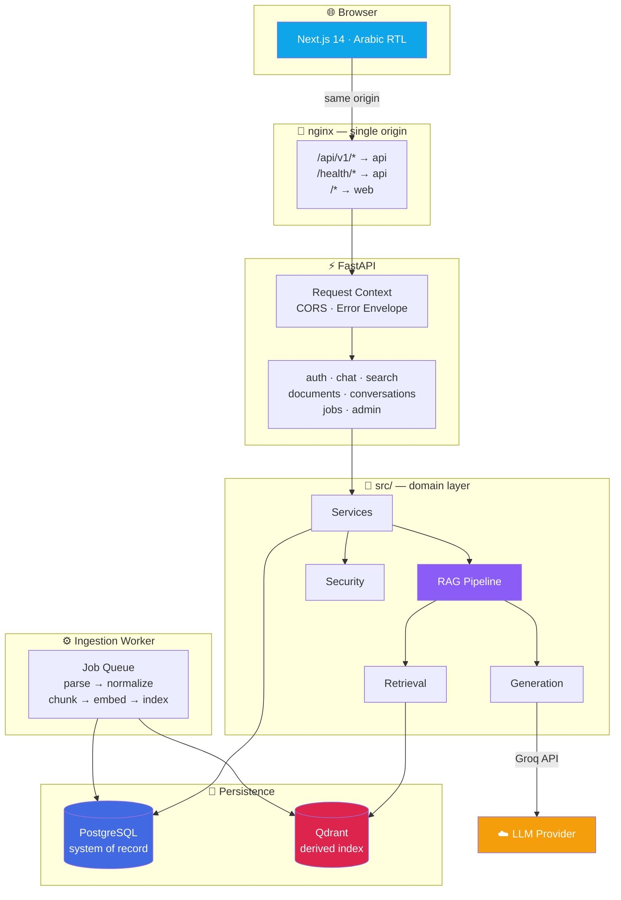

<div align="center">


# ميزان · MIZAN

### Egyptian Legal AI — An Arabic-First RAG System for Egyptian Legislation

**نظام أسئلة وأجوبة قانوني عربي، مبني على الاسترجاع المعزَّز، يوثّق كل إجابة برقم القانون والسنة والمادة.**

*A retrieval-augmented question-answering system that reads Egyptian law in Arabic,<br/>
and refuses to answer when the evidence isn't there.*

<br/>

[](https://www.python.org/)
[](https://fastapi.tiangolo.com/)
[](https://nextjs.org/)
[](https://www.typescriptlang.org/)
[](https://www.postgresql.org/)
[](https://qdrant.tech/)
[](https://www.docker.com/)
[](LICENSE)

[]()
[]()
[]()

<br/>

[**العربية**](#-العربية) · [**Overview**](#-overview) · [**Skills Demonstrated**](#-skills-demonstrated) · [**Engineering Log**](#-engineering-log) · [**Quick Start**](#-quick-start) · [**Architecture**](#-architecture)

</div>

---

## 📖 Table of Contents

<details>
<summary><b>Expand full navigation</b></summary>

- [Personal Note — Why I Built This](#-personal-note--why-i-built-this)
- [Overview](#-overview)
- [Why Egyptian Law Is a Hard NLP Problem](#-why-egyptian-law-is-a-hard-nlp-problem)
- [Skills Demonstrated](#-skills-demonstrated)
- [Disclaimer](#-disclaimer--إخلاء-مسؤولية)
- [System at a Glance](#-system-at-a-glance)
- [Architecture](#-architecture)
- [The Retrieval Pipeline](#-the-retrieval-pipeline)
- [Measured Performance](#-measured-performance)
- [Engineering Log](#-engineering-log)
- [Quick Start](#-quick-start)
- [Try It](#-try-it)
- [Configuration](#-configuration)
- [Hardware Constraints](#-hardware-constraints)
- [Project Structure](#-project-structure)
- [Quality & Testing](#-quality--testing)
- [Known Limitations](#-known-limitations)
- [Roadmap](#-roadmap)
- [What I Would Do Differently](#-what-i-would-do-differently)
- [Acknowledgments](#-acknowledgments)
- [License & Contact](#-license--contact)
- [العربية](#-العربية)

</details>

---

## 🎓 Personal Note — Why I Built This

> **This project is my attempt to answer one question: can I take what I learned in a classroom and ship it as a real, working system?**

I built **Mizan** while completing the **INSTANT Advanced AI Diploma** — not as a course assignment, but as a deliberate attempt to push every concept I studied past the notebook stage and into something that has to survive contact with reality.

A tutorial ends when the answer looks right. A system begins when you have to answer:

- What happens when two users upload documents at the same time?
- What happens when the vector database and the SQL database disagree?
- What happens when the model says *"I don't know"* — and the UI still shows two citations underneath it?
- What happens when a request takes 60 seconds and the browser gives up at 30?

Every one of those questions bit me during this build. **The [Engineering Log](#-engineering-log) below documents twenty of them** — the symptom, the diagnosis, the fix, and what it taught me. That section is the real portfolio piece. The features are the easy part.

<table>
<tr>
<td width="50%">

**What I wanted to prove**

- I can design an AI system end-to-end, not just call an API
- I understand *why* retrieval fails, not just that it did
- I can measure before I optimise
- I can debug across the full stack — model, service, transport, browser
- I can write code another engineer can maintain

</td>
<td width="50%">

**What I actually learned**

- Most "AI bugs" are ordinary engineering bugs wearing a costume
- A metric you haven't measured is a metric you've invented
- Silent failure is worse than loud failure
- Documentation is a debugging tool, not a chore
- Honest limitations read as competence, not weakness

</td>
</tr>
</table>

**Mizan** (ميزان) means *"scales"* — the instrument of balance and justice. I chose the name because the system's core discipline is **refusing to answer without evidence**. In legal work, a confident wrong answer is worse than no answer at all.

---

## 🔍 Overview

**Mizan** is a production-oriented Arabic legal research assistant. It ingests Egyptian legislation, indexes it two ways, retrieves with hybrid search, reranks with a cross-encoder, generates a grounded answer through an LLM, and **attaches a verifiable citation to every claim** — law number, year, article, section.

It is built around four non-negotiable rules:

| Rule | Implementation |
|---|---|
| **Every answer is traceable** | Citations are resolved from chunk *metadata*, never from model-authored text. The model cannot invent a law number that renders as a real citation. |
| **A refusal carries zero citations** | If the answer says «لا تتوفر معلومات كافية», the citation list is emptied. Showing sources under a refusal falsely implies it was evidenced. |
| **Official law ≠ user upload** | Curated corpus is shared; private uploads are owner-only — enforced in the library **and** in retrieval. |
| **Conversational ≠ legal** | «ما آخر سؤال سألته؟» is answered from history, never by BM25-matching `اخر` against 45,000 legal chunks. |

---

## 🧠 Why Egyptian Law Is a Hard NLP Problem

This is not a generic RAG demo with a different dataset. Arabic legal text breaks assumptions that English RAG tutorials never mention:

<table>
<tr><th>Challenge</th><th>Concrete example</th><th>How Mizan handles it</th></tr>
<tr>
<td><b>Two numeral systems</b></td>
<td>The corpus writes <code>المادة 147</code>. A user asks <code>المادة ١٤٧</code>.</td>
<td>Digit folding <code>١٤٧ → 147</code> applied <b>identically</b> to index and query. Verified in logs.</td>
</tr>
<tr>
<td><b>Hamza orthography</b></td>
<td><code>أحكام</code> / <code>احكام</code> · <code>السؤال</code> / <code>السوال</code></td>
<td>Symmetric folding: <code>أ إ آ → ا</code>, <code>ى → ي</code></td>
</tr>
<tr>
<td><b>Ta-marbuta</b></td>
<td><code>السرقة</code> vs <code>السرقه</code> — same word, different spelling</td>
<td>Folded for BM25 recall; <b>stored text and embeddings untouched</b></td>
</tr>
<tr>
<td><b>Diacritics & tatweel</b></td>
<td><code>الْعَقْد</code> · <code>العقــــد</code></td>
<td>Stripped before tokenisation, preserved in the displayed text</td>
</tr>
<tr>
<td><b>Article boundaries are semantic</b></td>
<td>Splitting Article 147 mid-paragraph loses the hardship exception — half the ruling</td>
<td>Legal-aware chunker preserves article units; <code>article_number</code> carried into the vector payload</td>
</tr>
<tr>
<td><b>Source authority matters legally</b></td>
<td>A user's PDF must never be presented as authoritative statute</td>
<td><code>scope</code> field: <code>official</code> vs <code>private</code>, surfaced in citations and UI</td>
</tr>
<tr>
<td><b>RTL + mixed-script UI</b></td>
<td>Arabic filenames, Latin IDs, Arabic legal prose in one row</td>
<td><code>dir="rtl"</code> on Arabic blocks, <code>dir="auto"</code> on user content</td>
</tr>
</table>

> **The single most common Arabic RAG failure:** normalising the index but not the query (or vice versa). The text exists, retrieval misses it, and everyone blames the embeddings. Mizan applies one normaliser to both paths — and logs the resulting tokens so asymmetry is visible immediately.

---

## 🛠 Skills Demonstrated

This project was built to exercise the full AI Engineering stack, not one slice of it.

### AI / ML Engineering

| Competency | Where it lives | Evidence |
|---|---|---|
| **Arabic NLP** | `src/preprocessing/` | Normalizer, legal structure parser, amendment parser, metadata extractor |
| **Semantic chunking** | `src/chunking/` | Legal-aware chunker + quality gate; article boundaries preserved |
| **Dense retrieval** | `src/embeddings/`, `src/retrieval/dense_retriever.py` | `multilingual-e5-base`, 768-dim cosine, query/document prefix asymmetry |
| **Sparse retrieval** | `src/retrieval/sparse_retriever.py` | BM25 over normalised Arabic, incremental index refresh |
| **Hybrid fusion** | `src/retrieval/score_fusion.py` | Reciprocal Rank Fusion with preserved provenance |
| **Neural reranking** | `src/reranking/` | Cross-encoder; activation contract diagnosed and corrected |
| **LLM orchestration** | `src/llm/` | Provider abstraction, priority routing, fallback chain, circuit breaker, cooldowns |
| **Prompt & context engineering** | `src/generation/` | Token-budgeted context assembly, citation formatting, response validation |
| **RAG architecture** | `src/rag/` | Query classification → decomposition → retrieval → rerank → generate → validate |
| **Evaluation design** | `src/evaluation/` | Retrieval, citation, answer, generation and Arabic-specific metrics *(implemented, not yet wired — see [limitations](#-known-limitations))* |

### Systems & Backend Engineering

| Competency | Where it lives |
|---|---|
| **API design** | `api/` — 7 routers, typed error envelope, request-ID tracing, OpenAPI contract |
| **Data modelling** | `src/storage/database/models/` — SQLAlchemy 2.x typed `Mapped[]`, soft deletes, tenant scoping |
| **Migrations** | Alembic, idempotent revisions, owner backfill |
| **Background processing** | `src/workers/` — Postgres-backed job queue, `FOR UPDATE SKIP LOCKED`, heartbeat reclaim, retry/backoff |
| **Security** | JWT lifecycle, bcrypt, RBAC, tenant + owner isolation, fail-closed access filters |
| **Observability** | Structured logging, pipeline stage timers, health/readiness probes, request correlation |
| **Frontend** | Next.js 14 App Router, TypeScript strict, shared polling store, RTL Arabic UI |
| **Deployment** | Multi-stage Dockerfiles, Compose with health gates, nginx single-origin proxy |

---

## ⚖️ Disclaimer / إخلاء مسؤولية

> **This system is a legal research aid, not legal advice.**
> The bundled corpus files are **illustrative excerpts** compiled for pipeline testing.
> For authoritative purposes, always verify against the Official Gazette (الجريدة الرسمية).

<div dir="rtl">

> **هذا النظام أداة بحث قانوني وليس استشارة قانونية.**
> النصوص المرفقة **مقتطفات توضيحية** جُمعت لاختبار خط المعالجة.
> للمرجعية الرسمية، راجع الجريدة الرسمية المصرية دائماً.

</div>

---

## 📊 System at a Glance

| Layer | Technology | Notes |
|---|---|---|
| **Language** | Arabic (RTL) | Egyptian legal terminology, symmetric normalisation |
| **Embeddings** | `intfloat/multilingual-e5-base` | 768-dim, cosine, CPU inference |
| **Sparse** | `rank-bm25` | In-memory, incremental refresh |
| **Fusion** | Reciprocal Rank Fusion | `k = 60`, provenance preserved |
| **Reranker** | `BAAI/bge-reranker-base` | Cross-encoder, single-sigmoid contract |
| **Generation** | Groq · `openai/gpt-oss-120b` | Priority routing + circuit breaker |
| **Vector store** | Qdrant 1.12 | Payload-indexed access filtering |
| **System of record** | PostgreSQL 16 | Documents, chunks, users, conversations, jobs |
| **API** | FastAPI | `/api/v1`, typed errors, request-ID tracing |
| **UI** | Next.js 14 + TypeScript | App Router, Tailwind, Arabic RTL |
| **Jobs** | Postgres queue + worker process | Heartbeat, reclaim, retry |
| **Edge** | nginx | Single origin → zero CORS preflights |
| **Cache** | Redis | *Scaffolded, deliberately disabled* |

---

## 🏗 Architecture



### Layer boundaries that are never crossed

```
web/   → never touches Postgres or Qdrant directly
api/   → no business logic, no SQL, no ML
src/   → never imports FastAPI or api/
```

**Why this matters:** the ingestion worker reuses the *entire* pipeline — parsing, normalisation, chunking, embedding, indexing — without duplicating a single line. That boundary is what makes a separate worker process possible at all.

### The retrieval flow

```
question
   │
   ├─► QueryClassifier
   │      └─ CONVERSATIONAL? ──► answer from history, ZERO retrieval, ZERO citations
   │
   └─► legal path
        │
        ├─ RetrievalPipeline.ensure_fresh()      ← rebuilds BM25 if Qdrant grew
        │
        ├─ Dense:  embed → Qdrant ANN → push-down filter → mandatory post-filter
        ├─ Sparse: normalize → tokenize → BM25 → same filter evaluator
        │
        ├─ RRF (k=60) ──► top 20 candidates, provenance preserved
        │
        ├─ Cross-encoder ──► raw logits ──► ONE sigmoid ──► MIN_RERANK_SCORE
        │
        ├─ Token-budgeted context assembly
        ├─ Groq generation
        ├─ Citation resolution from metadata
        └─ Validation ──► refusal? → suppress every citation
```

---

## 🔬 The Retrieval Pipeline

### One visibility policy, three independent enforcers

This is the architectural core of the isolation work — and the part I'm most satisfied with.

```
tenant_id == T
AND ( scope == "official"
      OR ( scope == "private" AND owner_id == me ) )
```

| Enforcer | Mechanism |
|---|---|
| **Dense** | Push-down to Qdrant `Filter` **plus a mandatory Python post-filter** |
| **Sparse** | `MetadataFilter.matches(chunk.metadata)` per candidate |
| **SQL** | `_visibility_clause()` predicate in the repository |

**Design rules:**

1. **Fail closed.** Missing or unrecognised `scope` ⇒ treated as `private`. An unowned private document is admin-only.
2. **Push-down is an optimisation, not a guarantee.** Any operator Qdrant cannot express is omitted from the pushed filter and settled by the post-filter. Over-fetching (4×) keeps `top_k` full.
3. **A translation error is fatal.** The original code logged a warning and searched *unfiltered*. That was an access-control bypass. It now raises.
4. **Payload and SQL stay in sync.** Changing a document's scope rewrites `scope`/`owner_id` on every Qdrant point — otherwise the document silently appears or disappears from search.

### Why orphaned vectors beat new ones

With 45,170 orphaned chunks and 32 fresh ones, a new chunk can only appear in the **dense** list (BM25 was frozen at startup):

| Candidate | RRF score |
|---|---|
| New chunk — dense rank 1 | `1/61` = **0.0164** |
| Old chunk — BM25 r1 + dense r5 | `1/61 + 1/65` = **0.0318** |

Old chunks score **~2× higher**. Then `RETRIEVAL_TOP_K=20 → RERANKER_TOP_K=5` discards the rest.

> **Conclusion: corpus hygiene is a retrieval requirement, not an ops nicety.** A stale vector store doesn't just waste disk — it actively out-ranks your correct answers.

---

## 📈 Measured Performance

Every number below came from `logs/app.log` on this machine. **None are estimated.**

### Chat latency breakdown (CPU, 12 cores, clean corpus)

| Stage | Cost | Share |
|---|---|---|
| Dense retrieval | 0.15 – 0.40 s | ~3% |
| Sparse retrieval | 0.04 – 0.14 s | ~1% |
| **Cross-encoder rerank (20 candidates)** | **7.4 – 8.8 s** | **65 – 88%** |
| Groq generation | 0.7 – 3.6 s | ~20% |
| **Total** | **~10 – 12 s** | |

> **Finding:** reranking dominates latency. It is only worth paying for if the model actually discriminates — see [Bug #3](#3-the-double-sigmoid-trap).

### Index build cost

| Corpus | BM25 build | Qdrant round-trips |
|---|---|---|
| 45,202 chunks | **28.1 s** | 177 |
| 32 chunks | **< 1 s** | 1 |

Arabic normalisation alone: **131 µs/chunk** → ~5.8 s for 45k chunks, single-core, GIL-bound.

### API latency (authenticated, localhost)

| Endpoint | Time |
|---|---|
| `GET /api/v1/documents` | **6.4 ms** |
| `GET /api/v1/conversations` | **10.7 ms** |
| `GET /api/v1/jobs` | **7.8 ms** |
| `POST /api/v1/auth/login` | **233 – 500 ms** ← bcrypt, by design |

### Query-time BM25

```
get_scores, 10 query tokens over 45,170 documents ≈ 67 ms
```

Pure Python, holds the GIL. Not a query bottleneck — but the **startup** cost is, because it runs inside the async lifespan.

---

## 🧪 Engineering Log

> **Bugs that taught me more than features.**
> Twenty real failures from this build — symptom, diagnosis, fix, lesson.
> This is the section I'd point a reviewer to first.

<details>
<summary><b>🔴 Security bugs (4)</b> — expand</summary>

### 1. Every user had every permission

**Symptom:** RBAC appeared to work. It didn't.

```python
def has_permission(auth, permission):
    if auth.is_admin:      # ← bound METHOD, always truthy
        return True
```

`AuthContext.is_admin` is a **method**, not a property. `if auth.is_admin:` is always `True`.

**Fix:** `if auth.is_admin():`
**Lesson:** Python truthiness will happily accept a bound method. Type hints don't catch this — a test does.

---

### 2. The vector store failed *open* on access filters

```python
try:
    qdrant_filter = self._build_qdrant_filter(filters)
except Exception as exc:
    logger.warning("Failed to build filter, searching without filter: %s", exc)
    qdrant_filter = None      # ← searches the ENTIRE collection
```

**Fix:** raise. A filter that cannot be enforced must never widen the search.
**Lesson:** `except → log → continue` is the most dangerous pattern in access control.

---

### 3. Nested filter groups were silently dropped

`_build_qdrant_filter` handled only `eq` and ignored nested groups. The policy
`tenant AND (official OR mine)` translated to `Filter(must=[tenant])` — the whole visibility branch vanished.

**Fix:** full recursive translation + mandatory post-filter using the same evaluator as sparse and SQL.
**Lesson:** when a policy is expressed in one place and enforced in three, they must share an evaluator — not three interpretations.

---

### 4. `operator` was declared but never read

```python
@dataclass
class MetadataFilter:
    operator: str = "and"   # supports "and", "or" — said the docstring
```

The retriever only checked `if cond.operator == "eq"`. So `or` behaved as `and`, and `neq/gt/lt/in` were **silently skipped** — the condition passed regardless.

**Fix:** one `matches()` evaluator, all operators, fail-closed on unknown fields.
**Lesson:** a declared-but-unread field is worse than an absent one. It looks implemented.

</details>

<details>
<summary><b>🟠 ML / retrieval bugs (4)</b> — expand</summary>

### 5. The double-sigmoid trap

**Symptom:** every rerank returned `top=0.5228, bottom=0.5000`. Two queries had *zero* spread across 20 candidates.

**Diagnosis:** `CrossEncoder.predict()` already applies `default_activation_function` — `nn.Sigmoid()` for `bge-reranker-base`. Applying a second sigmoid compresses everything into `[0.5, 0.622]`.

Inverting the scores proved it:

| Reported | Implied logit |
|---|---|
| 0.5000 | **0.000** |
| 0.5228 | 0.091 |

A healthy cross-encoder spans roughly `[-10, +10]`. A floor pinned at exactly `sigmoid(0)` on *every* query is the fingerprint of a clamp.

**Fix:** request `activation_fct=identity`, apply exactly one numerically-stable sigmoid, and **log the raw logits**:

```
RERANK RAW | logit_min=-9.1 | logit_max=6.4 | spread=15.5
RERANK NO SIGNAL | logit_spread=0.0001 across 20 candidates.
```

**Lesson:** the reranker cost 8.5 s per question to return a random ordering. *A component that runs is not a component that works.* Observability turned an invisible failure into a one-line diagnosis.

---

### 6. The BM25 index was frozen at startup

**Symptom:** uploaded a document, saw `32 chunks · Qdrant indexed`, asked about it — «لا تتوفر معلومات كافية».

**Timeline from the logs:**
```
13:01:25  BM25 READY | chunks=45170     ← index built here
13:14:52  POST /jobs/documents 202      ← document uploaded here
```

No rebuild hook existed. The new chunks were invisible to sparse retrieval.

**Fix:** `SparseRetriever.add_chunks()` + `RetrievalPipeline.ensure_fresh()` comparing Qdrant point count vs indexed count before every query.
**Lesson:** in-memory indexes need a lifecycle, not just a constructor.

---

### 7. Orphaned vectors out-ranked the correct answer

Wiped Postgres, forgot Qdrant. 45,170 vectors with no backing row. Chat cited **قانون رقم ٣٦٣ لسنة ١٩٥٦** — a law not present in *any* uploaded file.

**Fix:** reconciliation script + `delete_by_document()` on every deletion.
**Lesson:** a derived index must be reconstructible from the system of record. If it isn't, you have a split-brain corpus.

---

### 8. Indian digits vs Latin digits

The corpus writes `المادة 147`. Users type `المادة ١٤٧`.

**Verified working:**
```
BM25 QUERY | query=ما حكم المادة ١٤٧ من القانون المدني المصري؟
           | tokens=['حكم','الماده','147','القانون','المدني','المصري']
```

**Lesson:** normalisation must be *symmetric*. Log the tokens — asymmetry becomes obvious in one line.

</details>

<details>
<summary><b>🟡 Data & persistence bugs (4)</b> — expand</summary>

### 9. `Object of type UUID is not JSON serializable`

Every ingestion job failed at `chunk_repo.create_many()`. The traceback ended in `psycopg/types/json.py`.

**Diagnosis:** not a UUID *column* — a **JSONB column** receiving a dict containing live `uuid.UUID` objects.

**Fix:** one choke point, not every repository:
```python
create_engine(url, json_serializer=json_dumps)
```
Verified in SQLAlchemy's source that the psycopg dialect forwards this to `set_json_dumps`, covering **both** `json` and `jsonb` for **all** models.

**Lesson:** fix at the boundary, not at each call site. Also: `ensure_ascii=False` keeps Arabic readable in JSONB.

---

### 10. A processing document reported "failed"

```python
if db_status == FAILED: public = "failed"
elif chunk_count == 0:  public = "failed"   # ← PROCESSING lands here
```

During ingestion `chunk_count` is 0. The client saw `failed`, stopped polling, and displayed "Ingestion failed" while the worker was still running.

**Fix:** explicit mapping. `PENDING → uploaded`, `PROCESSING → processing`. Non-terminal states must stay non-terminal.
**Lesson:** derive status from *state*, never from a proxy metric.

---

### 11. Dangling `document_id` → permanent 404

A job pre-allocates `document_id`. If ingestion failed before the row was written, the job kept an ID resolving to nothing.

**Fix:** `_ensure_failed_record()` — guarantee a FAILED row exists so the reference never dangles.
**Lesson:** every foreign key needs a guaranteed target, especially on the failure path.

---

### 12. Schema drift between ORM and migrations

`scope` existed in SQL but not in Alembic's history. `indexed` existed in the ORM but not in migration 0001.

**Fix:** idempotent migration that inspects the live schema first; container entrypoint runs `alembic upgrade head` **before** serving, with `MIGRATE_STRICT=1`.
**Lesson:** `create_all()` and Alembic will happily disagree forever. Pick one authority.

</details>

<details>
<summary><b>🔵 Transport & frontend bugs (5)</b> — expand</summary>

### 13. Logs appeared minutes late, out of order

**Symptom:** clicked Documents, saw nothing in the log. Went to Chat. *Then* the Documents lines appeared.

**Diagnosis:** Uvicorn emits its access log inside the `http.response.start` branch — **when the handler responds, not when the request arrives.** Out-of-order logs mean requests *completed* out of order.

Compounded by: `--reload` creates the listening socket in the **reloader parent**, so traffic queues during the 28 s startup, then completes in a burst.

**Fix:** Compose `depends_on: {condition: service_healthy}`; scope `--reload-dir api --reload-dir src`.
**Lesson:** know *when* your logger fires before you trust its ordering.

---

### 14. INFO logs were silently discarded

```python
from src.config.logging_config import get_logger as configure_logging
configure_logging(__name__)     # ← just returns a logger. Configures nothing.
```

`setup_logging()` was never called. Root had no handlers → Python's `lastResort` (level WARNING) dropped every `logger.info()`.

**Proof:** the user saw `status=exception duration_ms=218.63` (from `logger.exception`) but **never** a `status=200 duration_ms=` line.

**Fix:** call `setup_logging()`; move file I/O to a `QueueHandler` so disk never blocks a request thread.
**Lesson:** an alias can hide a no-op. Every measurement I asked for was searching for lines that were never written.

---

### 15. Timeouts on a healthy server

`GET /documents` answered in 6 ms locally, but the browser reported «انتهت مهلة الاتصال».

**Diagnosis:** browsers allow ~6 HTTP/1.1 connections per origin. Polling saturated the pool; `fetch()` sat in the **browser queue** while the `AbortController` clock kept running. The request was cancelled *before being sent* — which is why it never appeared in the server log.

**Fix:** client-side concurrency gate; the deadline starts **at dispatch**, not at call. Queue waits reported separately as `phase: "queued"`.
**Lesson:** a timeout is not evidence the server is slow. Measure both ends.

---

### 16. CORS: three separate traps

| Trap | Effect |
|---|---|
| `CORS_ORIGINS: str` instead of `list[str]` | Starlette did **substring** matching |
| `allow_origin_regex` single-segment | `re.fullmatch` never matched a two-dot dev-tunnel origin |
| `@app.exception_handler(Exception)` | Lands on `ServerErrorMiddleware`, **outside** CORS → 500s lost their CORS headers → browser reported "connection lost" |

**Fix:** typed list, correct regex, CORS added **last** (outermost). Ultimately: nginx single-origin proxy → **zero preflights**.
**Lesson:** Starlette applies the last-added middleware as the outermost layer. Read the framework source when behaviour contradicts intuition.

---

### 17. "Objects are not valid as a React child"

An `ApiError` constructor received a details object in the `requestId` string slot. React tried to render it.

**Fix:** normalise in the constructor — `requestId` is always `string|null`, `details` always `object|null`. Render via `detailLines(): string[]`.
**Lesson:** make invalid states unrepresentable at the boundary, not at every render site.

</details>

<details>
<summary><b>⚪ Dependency & environment bugs (3)</b> — expand</summary>

### 18. `module 'jwt' has no attribute 'encode'`

Two PyPI distributions install a top-level `jwt` module: **PyJWT** (`encode`/`decode`) and **`jwt`** (actually *python-jwt*, `JWT()` objects). Neither was pinned in `requirements.txt`.

**Fix:** `pip uninstall -y jwt python-jwt PyJWT && pip install "PyJWT>=2.8,<3"`
**Lesson:** package name ≠ import name. Pin everything.

---

### 19. bcrypt's 72-byte ceiling — an Arabic-specific trap

bcrypt only considers the first **72 bytes**. An Arabic password of 40 characters is ~80 UTF-8 bytes. passlib silently truncates by default; bcrypt 5.x raises instead.

**Fix:** validate byte length explicitly, pin `bcrypt<5`.
**Lesson:** "72 characters" is wrong for any non-ASCII language. Count bytes.

---

### 20. PyJWT 2.10 rejects integer `sub`

`jwt.encode({"sub": user.id})` worked on 2.8. PyJWT ≥ 2.10 enforces `sub` must be a **string**, invalidating the token by default.

**Fix:** `str(user_id)` at issuance.
**Lesson:** a latent break on upgrade is still a break. Pin ranges, read changelogs.

</details>

---

## 🚀 Quick Start

### Option A — Docker (recommended)

```bash
git clone https://github.com/<your-username>/egyptian-legal-ai.git
cd egyptian-legal-ai

cp .env.example .env
# Fill in: POSTGRES_PASSWORD, JWT_SECRET_KEY, GROQ_API_KEY

docker compose --profile worker up -d --build
docker compose ps          # wait for all healthy
```

Open **http://localhost**. Migrations run automatically before the API serves.

| Profile | Adds |
|---|---|
| *(default)* | postgres, qdrant, api, web |
| `worker` | standalone ingestion process |
| `cache` | Redis — scaffolded, unused by code |

### Option B — Local development

```bash
conda activate genai

# 1 · Qdrant
docker start mizan-qdrant 2>/dev/null || docker run -d --name mizan-qdrant \
  --restart unless-stopped -p 127.0.0.1:6333:6333 -p 127.0.0.1:6334:6334 \
  -v qdrant-data:/qdrant/storage qdrant/qdrant:v1.12.4

# 2 · PostgreSQL (system service — verify, don't start)
pg_isready -h localhost -p 5432

# 3 · API — wait for "Application startup complete"
export OMP_NUM_THREADS=2 MKL_NUM_THREADS=2 TOKENIZERS_PARALLELISM=false
uvicorn api.main:app --host 0.0.0.0 --port 8000 \
  --reload --reload-dir api --reload-dir src

# 4 · Web (new terminal)
cd web && npm run dev
```

> ⚠️ **Wait for `Application startup complete.`** With `--reload`, the socket listens during startup — requests sent too early queue silently.

📖 Full runbook, verification suite, reset procedure and a symptom→cause table: **[`docs/RUNBOOK.md`](docs/RUNBOOK.md)**

---

## 🧪 Try It

```bash
TOKEN=$(curl -s -X POST http://localhost:8000/api/v1/auth/login \
  -H 'Content-Type: application/json' \
  -d '{"email":"you@example.com","password":"YourPassword"}' \
  | python -c 'import sys,json;print(json.load(sys.stdin)["access_token"])')

# Upload a legal text
curl -s -X POST http://localhost:8000/api/v1/jobs/documents \
  -H "Authorization: Bearer $TOKEN" \
  -F "file=@egyptian_legal_corpus.md"

# Ask about a specific article — Indian digits must match Latin digits
curl -s -X POST http://localhost:8000/api/v1/chat \
  -H "Authorization: Bearer $TOKEN" \
  -H 'Content-Type: application/json' \
  -d '{"question":"ما حكم المادة ١٤٧ من القانون المدني المصري؟"}' \
  | python -m json.tool
```

**Expected:** Article 147 with **both** paragraphs — *pacta sunt servanda* **and** the hardship exception — cited as `القانون المدني رقم 131 لسنة 1948`.

### Three acceptance tests worth running

| Test | Expected |
|---|---|
| «ما حكم المادة ١٤٧ من القانون المدني المصري؟» | Both paragraphs cited, law 131/1948 |
| «ما آخر سؤال سألته لك؟» | Answered from history, **zero citations** |
| A question with no matching evidence | Refusal, **zero citations** |

---

## ⚙️ Configuration

All settings come from `.env` via `src/config/settings.py` (pydantic-settings). **No secrets in code.**

```bash
cp .env.example .env
python -c "import secrets; print(secrets.token_urlsafe(64))"   # JWT_SECRET_KEY
```

> ⚠️ `Settings` uses `extra="ignore"` — **a misspelled key is silently discarded.**
> Several bugs in this project's history came from exactly that: `QDRANT_COLLECTION` vs `QDRANT_COLLECTION_NAME`, a duplicated `METRICS_ENABLED`, `SECRET_KEY` vs `JWT_SECRET_KEY`.

`.env.example` documents every variable and flags the ones that are **dead config**.

---

## 💻 Hardware Constraints

Built and measured on: **Ubuntu 24.04 · Python 3.11 · 32 GB RAM · 12 cores · NVIDIA Quadro P2000 4 GB (Pascal sm_61)**

| Model | Device | Reasoning |
|---|---|---|
| `multilingual-e5-base` (278M) | CPU | Fits in 4 GB, but two models + CUDA context is tight |
| `bge-reranker-base` (278M) | CPU | Same |
| `Qwen2.5-3B-Instruct` | **disabled** | bf16 needs ~6 GB > 4 GB; 4-bit needs Turing+ (sm_75+) |

Generation is therefore **API-only**. Setting `LOCAL_MODEL_NAME=` and `LLM_FALLBACK_ORDER=` keeps ~6 GB of RAM free instead of loading a model that can never serve a request.

Torch threads are capped at 2 — with 12 cores and three CPU models, default oversubscription slows *every* request.

> **Engineering note:** these are hardware facts, not preferences. Documenting them prevents a future reviewer from "optimising" by enabling GPU inference and losing an afternoon.

---

## 📁 Project Structure

```
egyptian-legal-ai/
├── api/                    FastAPI — routes, schemas, middleware, lifespan
│   ├── routes/             7 routers under /api/v1
│   ├── middleware/         request context, timing, CORS-safe errors
│   └── schemas/            Pydantic request/response contracts
│
├── src/                    Domain layer — never imports FastAPI
│   ├── preprocessing/      Arabic normalizer, legal structure parser
│   ├── chunking/           legal-aware chunker + quality gate
│   ├── embeddings/         sentence-transformers adapter + registry
│   ├── retrieval/          dense · sparse · RRF · metadata filters
│   ├── reranking/          cross-encoder + pipeline
│   ├── generation/         prompts, context builder, citation formatter
│   ├── rag/                classifier, decomposer, orchestrator, pipeline
│   ├── llm/                providers, routing, fallback, circuit breaker
│   ├── services/           document · chat · search · conversation · auth
│   ├── storage/            models, repositories, migrations, document store
│   ├── security/           authentication, authorization, tenant isolation
│   ├── monitoring/         health, metrics, tracing, stage timers
│   └── evaluation/         retrieval · citation · answer · Arabic metrics
│
├── web/                    Next.js 14 — App Router, TypeScript strict
│   ├── src/app/            chat · documents · login · register
│   ├── src/components/     ui · chat · documents · legal · sidebar
│   ├── src/hooks/          useChat · useDocuments · usePolling
│   └── src/lib/            typed API client · auth · health store
│
├── workers/                standalone ingestion entry point
├── deployment/             Dockerfiles · nginx · entrypoint
├── docs/                   architecture · retrieval · data model · security · runbook
├── scripts/                bulk_ingest · reset_db · diagnose_text_quality
├── tests/                  unit (3 files) — see limitations
└── data/                   documents · raw/official_laws · processed
```

---

## ✅ Quality & Testing

```bash
ruff check api src workers scripts
mypy api src
pytest tests -q
alembic -c src/storage/database/migrations/alembic.ini upgrade head
```

### Observability built in

```bash
# Retrieval quality — the lines that tell you whether ranking works
grep -E "RERANK RAW|RERANK NO SIGNAL|RERANK THRESHOLD|RRF FUSION|DENSE FILTER|BM25 QUERY" \
  logs/app.log | tail -20

# Per-request timing with correlation IDs
grep "duration_ms" logs/app.log | tail -30

# Corpus reconciliation — orphans must be zero
python scripts/diagnose_text_quality.py
```

**Every request carries a `request_id`** propagated from nginx through FastAPI into the logs, so a user-reported error maps to one `grep`.

---

## ⚠️ Known Limitations

I'd rather state these plainly than have a reviewer discover them.

| Gap | Status | Impact |
|---|---|---|
| **Job listing not owner-scoped** | 🔴 Open | A user can see other users' job filenames and errors |
| **Chat retrieval doesn't pass the visibility filter** | 🔴 Open | Library hides private docs, but retrieval may still surface their text |
| **No golden evaluation set** | 🟠 Open | `src/evaluation/` is complete and nothing runs it. Every retrieval change is currently unverifiable. |
| **Test coverage** | 🟠 Open | `tests/api/`, `tests/integration/`, `tests/evaluation/` contain only `__init__.py` |
| **No CI** | 🟠 Open | No lint/typecheck/test gate |
| **No token revocation** | 🟡 Open | Logout is client-side only |
| **No streaming** | 🟡 Open | `generate_stream` declared, not exposed. Requires converting middleware off `BaseHTTPMiddleware` first. |
| **Redis caching** | ⚪ Scaffolded | Highest-leverage remaining latency win |

Tracked in **[`docs/KNOWN_ISSUES.md`](docs/KNOWN_ISSUES.md)**.

> The two 🔴 items must close before this is safe for real multi-user use. For a demo, run with the official corpus only and uploads disabled.

---

## 🗺 Roadmap

```
Phase 1–10   ✅  Corpus · Arabic NLP · chunking · embeddings · Qdrant
                 hybrid retrieval · reranking · LLM routing · generation
Phase 11–13  ✅  PostgreSQL · Alembic · auth · FastAPI surface
Phase 14–16  ✅  Next.js UI · worker · monitoring
Phase 17     🔶  Evaluation — implemented, not wired
Next         🔴  Owner scoping (jobs + retrieval)
             🟠  Golden eval set · CI · test coverage
             🟡  Streaming · Redis caching · amendment-aware versioning
```

**Definition of done for a public release:**

- [ ] Cross-user isolation verified for documents, chunks, **jobs** and **retrieval**
- [ ] Article 147 returns both paragraphs with correct citation
- [ ] Meta-questions answer from history with zero citations
- [ ] Refusals carry zero citations
- [ ] `RERANK RAW` shows a real logit spread
- [ ] Zero orphaned Qdrant points
- [ ] `docker compose up` reaches all-healthy from empty volumes
- [ ] Evaluation set runs and reports retrieval + citation metrics

---

## 💭 What I Would Do Differently

Honest retrospective — the part a portfolio usually leaves out.

**1. Build the evaluation set first.**
I spent days tuning retrieval with no ground truth. Thirty questions with expected article numbers would have made every decision measurable instead of intuitive. `src/evaluation/` exists and is unused — that's the biggest miss in this project.

**2. Write the integration tests before the second user existed.**
The isolation bugs were only discovered by manually registering a second account. One cross-user test would have caught both 🔴 issues in seconds.

**3. Pin every dependency from day one.**
`jwt` vs `PyJWT`, `bcrypt` 5.x, PyJWT 2.10's `sub` change — three separate multi-hour detours, all preventable with a lockfile.

**4. Instrument before optimising.**
I initially blamed the GIL, the filesystem, and the dev tunnel for latency. The actual culprit was a reranker returning constant scores. One log line of raw logits would have found it immediately.

**5. Treat documentation as a debugging tool.**
Half the confusion came from docs saying *Streamlit in `frontend/`* while the code was *Next.js in `web/`*. Stale docs actively mislead — including your future self.

**6. Design the process boundary earlier.**
Running CPU-bound ingestion inside the async API process was a decision I inherited from the tutorial-shaped starting point. Separating it later meant touching the factory, lifespan, worker and Compose file.

---

## 🙏 Acknowledgments

**INSTANT — Advanced AI Diploma**
This project is my attempt to apply, end-to-end, everything the diploma covered: NLP, embeddings, vector search, retrieval strategies, reranking, LLM integration, prompt engineering, evaluation, and deployment. The curriculum gave me the concepts; building Mizan taught me the difference between a concept and a system.

**Open-source foundations**

| Project | Role |
|---|---|
| [Sentence-Transformers](https://www.sbert.net/) | Multilingual embeddings + cross-encoder |
| [Qdrant](https://qdrant.tech/) | Vector search with payload filtering |
| [rank-bm25](https://github.com/dorianbrown/rank_bm25) | Sparse retrieval |
| [FastAPI](https://fastapi.tiangolo.com/) · [Pydantic](https://docs.pydantic.dev/) | Typed API contracts |
| [Next.js](https://nextjs.org/) · [Tailwind CSS](https://tailwindcss.com/) | Arabic RTL interface |
| [Groq](https://groq.com/) | Fast LLM inference |
| [Hugging Face](https://huggingface.co/) | `multilingual-e5-base`, `bge-reranker-base` |

**Corpus note:** the bundled legal excerpts were assembled for pipeline testing. They are illustrative, not authoritative. Always verify against the Official Gazette.

---

## 📄 License & Contact

**MIT** © 2026 — see [LICENSE](LICENSE).

Built by **Ahmed** as a portfolio project demonstrating end-to-end AI Engineering.

<div align="center">

[](https://github.com/<your-username>)
[](https://linkedin.com/in/<your-profile>)
[](mailto:<your-email>)

*If you're reviewing this as part of a hiring process —<br/>
the [Engineering Log](#-engineering-log) is the section I'd read first.*

</div>

---

<div dir="rtl">

## 🇪🇬 العربية

<div align="right">

### ميزان — الذكاء القانوني المصري

**ميزان** نظام أسئلة وأجوبة قانوني عربي مبني على الاسترجاع المعزَّز (RAG)،
مصمَّم للنصوص التشريعية المصرية. يسترجع المواد القانونية من فهرس متجهي وفهرس
كلمية، يعيد ترتيبها بمُعيد ترتيب عصبي، ثم يولّد إجابة موثَّقة برقم القانون
والسنة والمادة والفصل.

#### لماذا هذا المشروع؟

بنيته أثناء دراستي في **دبلومة الذكاء الاصطناعي المتقدمة — INSTANT**، كمحاولة
لتطبيق كل ما تعلمته في نظام حقيقي يعمل، لا مجرد دفتر تجارب.

الفرق بين الدرس والنظام أن الدرس ينتهي عندما تبدو الإجابة صحيحة، أما النظام
فيبدأ عندما تسأل: ماذا يحدث عندما يرفع مستخدمان مستندين في نفس اللحظة؟ ماذا
حدث عندما يختلف سجل المتجهات عن قاعدة البيانات؟ ماذا حدث عندما يقول النموذج
«لا أعرف» وتظل الواجهة تعرض مصدرين تحت الإجابة؟

كل هذه الأسئلة واجهتني فعلياً، ووثّقتها في **[سجل الهندسة](#-engineering-log)**.

#### التحديات الخاصة باللغة العربية

| التحدي | الحل |
|---|---|
| نظامان للأرقام (`١٤٧` و `147`) | طيّ الأرقام بشكل متماثل في الفهرس والسؤال |
| الهمزات (`أحكام` / `احكام`) | طيّ `أ إ آ → ا`، `ى → ي` |
| التاء المربوطة (`السرقة` / `السرقه`) | طيّ للبحث الكلمية فقط، دون المساس بالنص المخزَّن |
| التشكيل والتطويل | إزالة قبل التقطيع، مع الحفاظ على النص المعروض |
| حدود المواد القانونية | تقطيع يحافظ على وحدة المادة كاملة |
| سلطة المصدر | تمييز المصدر الرسمي عن مستند المستخدم |

#### المبادئ الأربعة

1. **كل إجابة قابلة للتتبع** — الاستشهادات تُستخرج من البيانات الوصفية، لا من نص النموذج.
2. **الرفض بلا استشهادات** — «لا تتوفر معلومات كافية» لا تُعرض مع مصادر.
3. **المصدر الرسمي ≠ مستند المستخدم** — عزل على مستوى المكتبة والاسترجاع معاً.
4. **السؤال الحواري ≠ السؤال القانوني** — «ما آخر سؤال سألته؟» يُجاب من الذاكرة.

#### المساهمة

المكتبة الرسمية مفتوحة للمراجعة. أضف مستندك القانوني من صفحة **المكتبة القانونية**،
وسيُراجَع قبل إضافته إلى المصادر الرسمية.

**هل لديك مصدر قانوني لم نجده هنا؟** — المساهمات مرحّب بها. افتح *issue* يتضمن
اسم القانون، أرقام المواد، ومرجع الجريدة الرسمية.

#### تنبيه

هذا النظام **أداة بحث قانوني وليس استشارة قانونية**. النصوص المرفقة مقتطفات
توضيحية للاختبار. للمرجعية الرسمية، راجع **الجريدة الرسمية المصرية**.

</div>

</div>

---

<div align="center">

**صُنع بـ ❤️ في مصر · Built with ❤️ in Egypt**

<sub>Mizan (ميزان) — the scales. Because in legal work, a confident wrong answer<br/>
is worse than no answer at all.</sub>

</div>